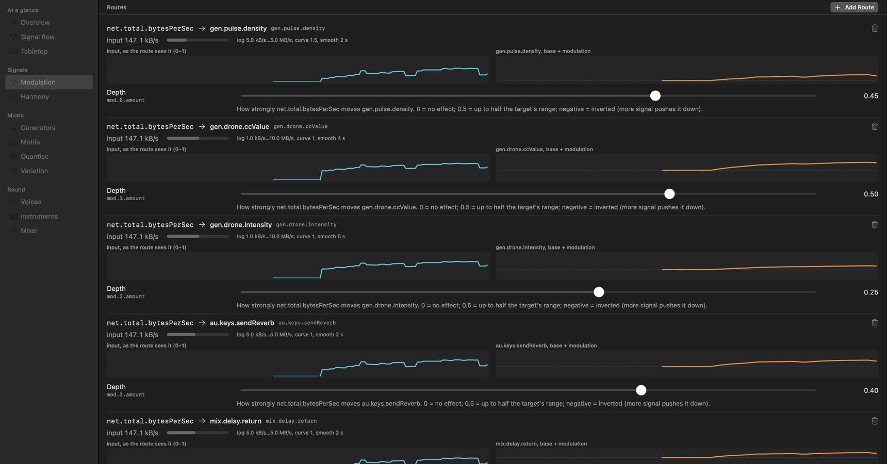
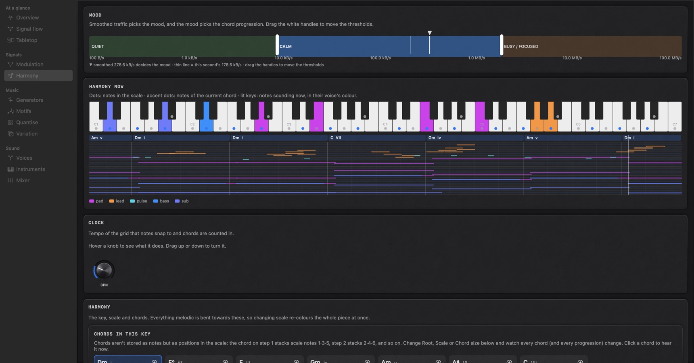
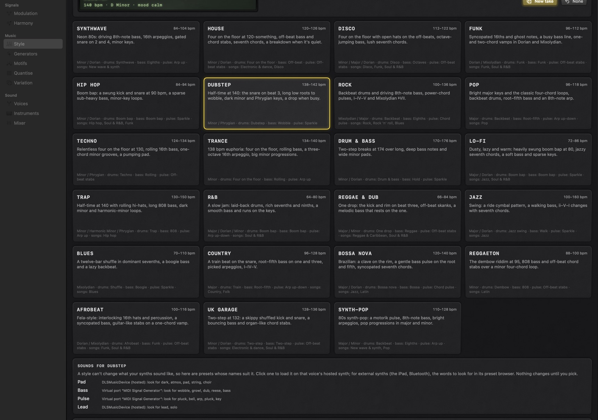
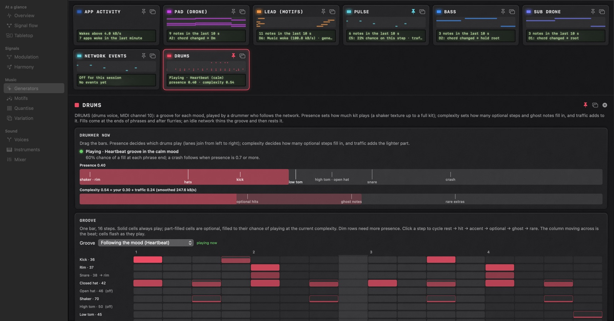
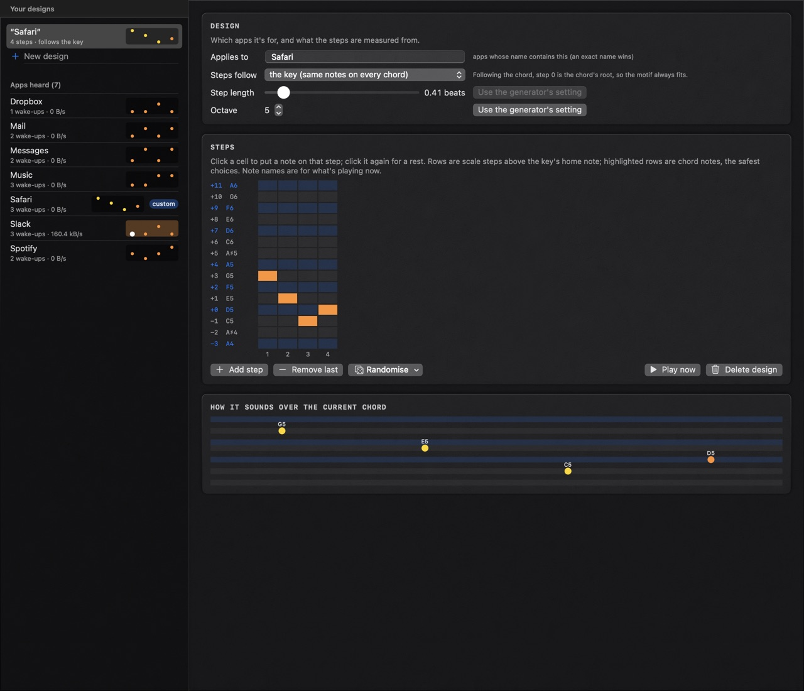
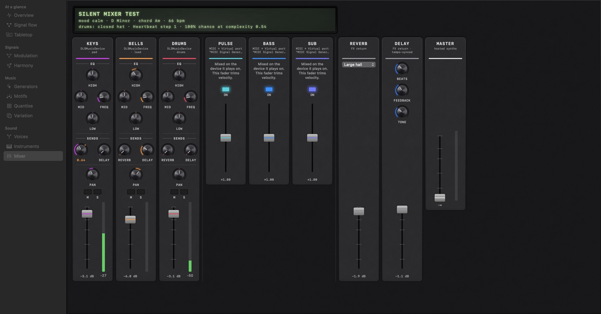

# MIDI Signal Generator

[](https://github.com/timhodson/midi-signal-generator/actions/workflows/ci.yml)

Turns data signals into ambient MIDI streams: 90s modem handshake sounds, re-imagined for
today's networks. It starts with **this Mac's network traffic**. The whole LAN and
sensors (temperature, humidity, motion) come later.

Each app on the Mac gets its own motif when it wakes up. Overall traffic drives pulse density
and pad brightness. The network's "mood" (quiet / calm / busy / focused) picks the chord
progression, and a flurry of apps waking at once triggers a cadence. **Every musical decision
is a tunable parameter**, from raw sonification to tidy ambient music.

## Demo

A two-minute tour of the app (with sound): the Overview, signal flow, harmony and chords from
songs, styles and variations, motifs, quantise, voices and the mixer. It plays the synthetic
source, so no real traffic is shown.

https://github.com/user-attachments/assets/fccfa971-47e4-448b-a41b-853d7b650748

## Download

Builds for Apple silicon Macs (macOS 15 or later) are on the
[Releases](https://github.com/timhodson/midi-signal-generator/releases) page. They're unsigned: after
unzipping, run `xattr -dr com.apple.quarantine midi-signal-generator-*`, then `./msg-app` from the folder
(INSTALL.txt in the zip has the details). To cut a release, push a version tag: `git tag v0.1.0 && git push
origin v0.1.0`. The Release workflow tests, builds and publishes it.

`msg-app` is all you need. `msg-cli` is the same engine without a window: run it headless, print
the notes it would play (`--dry-run --verbose`), list MIDI ports, synths, effects and presets, and
record or replay traffic. `msg-pcap` is the optional packet-capture helper.

## Quick start

```sh
swift run -c release msg-app --scene scenes/audiokit-hosted.json   # the Mac app (release: much lighter)
swift build
.build/debug/msg-cli --source synthetic --dry-run   # hear nothing, see the notes
.build/debug/msg-cli --verbose                      # real traffic → virtual MIDI port "MIDI Signal Generator"
.build/debug/msg-cli --scene scenes/audiokit-hosted.json   # Synth One J6 + King of FM, hosted in-app
.build/debug/msg-cli --au pad="Synth One J6@Intersteller Pad"  # any AU synth per role
.build/debug/msg-cli --dest network                 # → iPad via network MIDI (docs/midi-setup.md)
.build/debug/msg-cli --list-params                  # all ~80 parameters (hundreds more with hosted synths)
.build/debug/msg-cli --set macro.faithfulness=0.9   # closer to raw data
.build/debug/msg-cli --packets                      # + DNS lookups, handshakes, LAN chatter (msg-pcap, ADR 0015)
.build/debug/msg-pcap --print                         # see packet features (needs sudo or ChmodBPF)
.build/debug/msg-cli --record recordings/evening.jsonl          # capture the traffic…
.build/debug/msg-cli --source replay:recordings/evening.jsonl  # …and replay it while tuning
```

Voices: `pad` = ch 1, `lead` = ch 2, `pulse` = ch 3, `bass` = ch 4, `sub` = ch 5, `drums` = ch 10 (all tunable).
The drummer (ADR 0016) plays General MIDI drums; hosted scenes get Apple's built-in kit automatically.

## Feature guide

The Mac app (`msg-app`) shows every parameter as a control, and next to each group it shows what that group is doing right
now. The sidebar follows the signal path: **At a glance** → **Signals** → **Music** → **Sound**. The toolbar switches
between the plain **System** look and the hardware-style **Studio** skin, and has Save, Record and the
Randomise dice. The screenshots below use the Studio skin, with synthetic traffic and the master turned down.

### At a glance

**Overview**: mood, chord, tempo, traffic and output level. A 3-minute traffic graph with the quiet/busy
thresholds (drag a dashed line to move it), the busiest apps, and every recent note with the reason it played. The **Faithfulness** macro
goes from tidy and musical (0) to raw sonification (1).


**Signal flow**: the whole patch on one page: signals → generators → voices → outputs. Solid cables carry
notes, dashed ones carry control, and amber dotted ones are modulation routes, glowing as they push their target.
Hover over a box to light its path, or click it to edit its settings in the inspector.


**Tabletop**: pin any panel (📌, right-click, or the toolbar's Add menu) to build your own control
surface. Any panel can also pop out into its own window.


### Signals

**Modulation**: two tempo-synced LFOs (a CC to a voice, or a signal for routes), and routes from a signal such as total traffic to any parameter, with range,
curve, smoothing and depth. Each route shows its input and the target's value moving live.



**Harmony**: the mood thresholds (drag the handles), the key and scale on a keyboard, a piano roll of
every voice against the chords, plus tempo, scale, chord size and a chord progression for each mood.
**From a song…** borrows a verse or chorus from 734 hand-annotated Billboard hits (search by title, artist, decade
or genre) or takes typed chords ("Am F C G"). A progression you pick, type or edit is pinned (📌): variations and styles
leave its chords alone (they can still move the key and scale), and Reset or the pin releases it. The Clock section sends MIDI clock to external synths.



### Music

**Style**: 23 genres, from Synthwave, House, Techno, Trance, Drum & bass and Dubstep to Funk, Disco, Hip hop,
Lo-fi, Trap, R&B, Reggae & dub, Jazz, Blues, Country, Bossa nova, Reggaeton, Afrobeat, UK garage, Rock, Pop and
Synth-pop. A style sets tempo, scale, chord progressions (some borrowed from real songs of that genre), drum
grooves, bass figures, arpeggios and LFOs (the dubstep wobble, house pumping), all as ordinary settings, and
suggests matching presets on your synths. The network still drives it: a quiet network is the breakdown, a busy
one the drop. **New take** rolls a fresh tempo, scale and progressions; Variation stays inside the style.



**Generators**: one tile per generator: pad drone, lead motifs, pulse, bass, sub drone, network
events (DNS lookups, handshakes, LAN chatter from `msg-pcap`) and the **drummer**. Each tile shows its
recent notes and what it's doing; click one to open it. The drummer has a groove for each mood, with **presence**
(how much of the kit plays) and **complexity** (how many optional and ghost notes fill in). Fills come at phrase
ends, and the step grid is editable.



**Motifs**: each app that wakes up plays its own short tune on the lead voice. Every app heard is listed,
and you can customise one or design a step pattern that follows the key or the chord.



**Quantise**: how strongly timing, pitch and density are pulled towards the grid, the scale and a sane note
count.

**Variation**: a fresh take on the piece, either on demand (the dice) or on a schedule (5 min to 4 h), always
landing on a phrase boundary. **Deviation** sets how far it strays: 0.1 nudges the key, 1 changes nearly
everything. Choose what varies (harmony, motifs, generators, tempo, drums), vary from **Home** or drift from
where the piece is now, and read what changed on the LCD.


The middle of the toolbar has **play/pause** (⌘↩: the music holds, everything stays loaded),
**randomise** and **stop** (⌘.: unloads the session, hosted synths too). File → **Open Recent**
lists recent scenes, and the app starts with the scene you saved last.

**Intro**: the piece builds up over its first bars (`conductor.introBars`, 4 by default, on the
Harmony page): the pad and sub first, the bass, then pulse and drums, which land with a fill, and
the apps' motifs once it's going. It starts in the mood the network is already in, and apps that
were busy before you pressed play don't all "wake up" at once.

### Sound

**Voices**: each voice's sound in one place. Choose where its notes go (a hosted synth, the
virtual MIDI port, network MIDI to an iPad, or Bluetooth MIDI) and, for a hosted synth, its
preset, volume, pan, editor window and every synth parameter. **Layers** play the same notes on
more sounds at once (the pad on Synth One *and* the iPad, an octave up, a little later), each with
its own channel, transpose, level and delay. **Effects**: put Audio Unit effects (delay, chorus,
distortion…) after a hosted synth, with bypass, presets and their own editors. "New hosted synth"
in the destination menu loads another one. Each voice also has its channel, transpose, range and
polyphony.

**Mixer**: for hosted synths: 3-band EQ, reverb and tempo-synced delay sends, pan, mute and solo, faders
and meters, and a master. External MIDI voices get a velocity trim.



Screenshots are regenerated offscreen with
`msg-app --scene … --source synthetic --snapshot DIR --width 1720 --skin studio` (see [Development](docs/development.md)).

## Credits

- Song chords: [The McGill Billboard Project](https://ddmal.music.mcgill.ca/research/The_McGill_Billboard_Project_(Chord_Analysis_Dataset))
  (J. A. Burgoyne, J. Wild, I. Fujinaga, "An Expert Ground Truth Set for Audio Chord Recognition and Music
  Analysis", ISMIR 2011), CC0. Genres: [Wikidata](https://www.wikidata.org), CC0.
- Built with AudioKit's [Tonic](https://github.com/AudioKit/Tonic) and [Controls](https://github.com/AudioKit/Controls),
  and [swift-midi-io](https://github.com/orchetect/swift-midi-io).

## Docs

- [Architecture](docs/architecture.md)
- [The app](docs/decisions/0012-mac-app-generated-from-params.md)
- [Decisions (ADRs)](docs/README.md#decisions-adrs)
- [MIDI setup (hosted AU synths, iPad, DAW, Bluetooth)](docs/midi-setup.md)
- [Development](docs/development.md) · [Roadmap](docs/roadmap.md)
