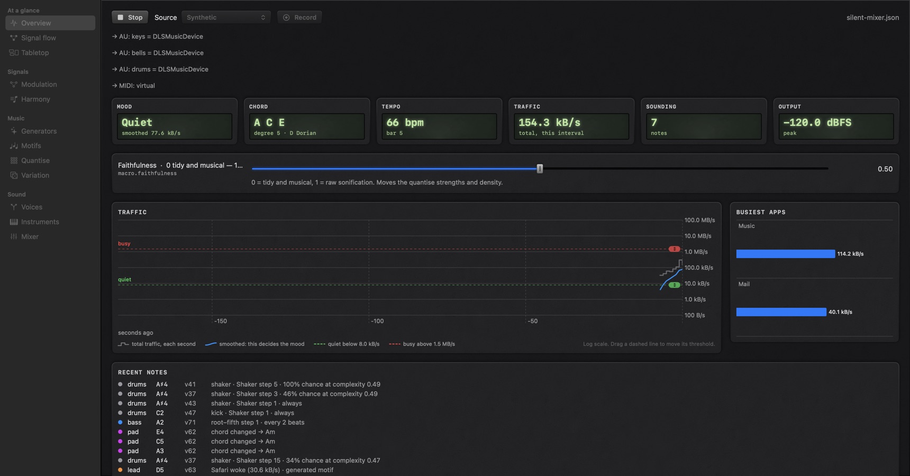
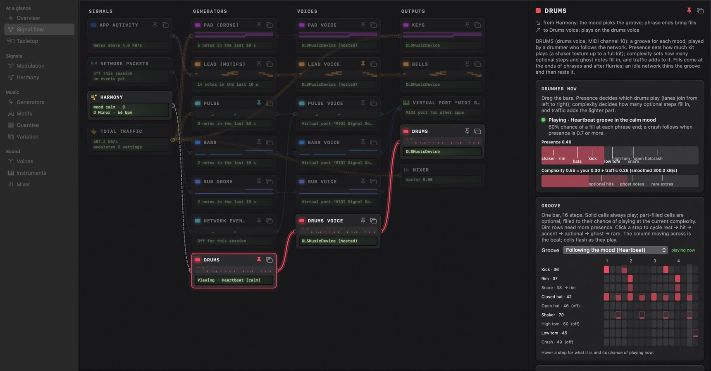
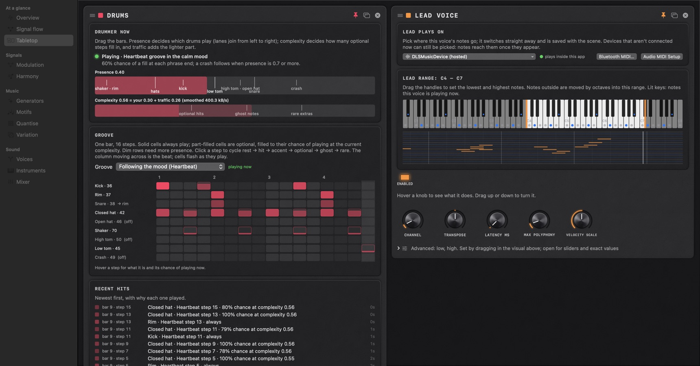
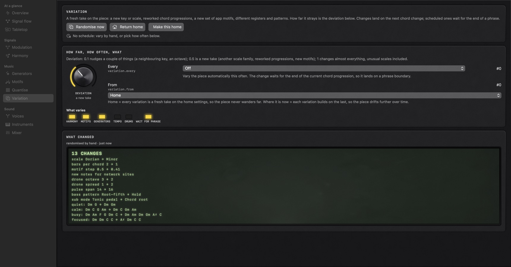

# MIDI Signal Generator

Turns data signals into ambient MIDI streams: 90s modem handshake sounds, re-imagined for
today's networks. It starts with **this Mac's network traffic**. The whole LAN and
sensors (temperature, humidity, motion) come later.

Each app on the Mac gets its own motif when it wakes up. Overall traffic drives pulse density
and pad brightness. The network's "mood" (quiet / calm / busy / focused) picks the chord
progression, and a flurry of apps waking at once triggers a cadence. **Every musical decision
is a tunable parameter**, from raw sonification to tidy ambient music.

## Quick start

```sh
swift run -c release msg-app --scene scenes/audiokit-hosted.json   # the Mac app (release: much lighter)
swift build
.build/debug/msg-spike --source synthetic --dry-run   # hear nothing, see the notes
.build/debug/msg-spike --verbose                      # real traffic → virtual MIDI port "MIDI Signal Generator"
.build/debug/msg-spike --scene scenes/audiokit-hosted.json   # Synth One J6 + King of FM, hosted in-app
.build/debug/msg-spike --au pad="Synth One J6@Intersteller Pad"  # any AU synth per role
.build/debug/msg-spike --dest network                 # → iPad via network MIDI (docs/midi-setup.md)
.build/debug/msg-spike --list-params                  # all ~80 parameters (hundreds more with hosted synths)
.build/debug/msg-spike --set macro.faithfulness=0.9   # closer to raw data
.build/debug/msg-spike --packets                      # + DNS lookups, handshakes, LAN chatter (msg-pcap, ADR 0015)
.build/debug/msg-pcap --print                         # see packet features (needs sudo or ChmodBPF)
.build/debug/msg-spike --record recordings/evening.jsonl          # capture the traffic…
.build/debug/msg-spike --source replay:recordings/evening.jsonl  # …and replay it while tuning
```

Voices: `pad` = ch 1, `lead` = ch 2, `pulse` = ch 3, `bass` = ch 4, `sub` = ch 5, `drums` = ch 10 (all tunable).
The drummer (ADR 0016) plays General MIDI drums; hosted scenes get Apple's built-in kit automatically.

## Feature guide

The Mac app (`msg-app`) shows every parameter as a control, and next to each group it shows what that group is doing right
now. The sidebar follows the signal path: **At a glance** → **Signals** → **Music** → **Sound**. The toolbar switches
between the plain **System** look and the hardware-style **Studio** skin, and has Save, Record and the
Randomise dice. The screenshots below use the Studio skin, with synthetic traffic and the master turned down.

### At a glance

**Overview**: mood, chord, tempo, traffic and output level. A 3-minute traffic graph with the quiet/busy
thresholds (drag a dashed line to move it), the busiest apps, and every recent note with the reason it played. The **Faithfulness** macro
goes from tidy and musical (0) to raw sonification (1).



**Signal flow**: the whole patch on one page: signals → generators → voices → outputs. Solid cables carry
notes, dashed ones carry control, and amber dotted ones are modulation routes, glowing as they push their target.
Hover over a box to light its path, or click it to edit its settings in the inspector.



**Tabletop**: pin any panel (📌, right-click, or the toolbar's Add menu) to build your own control
surface. Any panel can also pop out into its own window.



### Signals

**Modulation**: routes from a signal such as total traffic to any parameter, with range,
curve, smoothing and depth. Each route shows its input and the target's value moving live.


**Harmony**: the mood thresholds (drag the handles), the key and scale on a keyboard, a piano roll of
every voice against the chords, plus tempo, scale, chord size and a chord progression for each mood.


### Music

**Generators**: one tile per generator: pad drone, lead motifs, pulse, bass, sub drone, network
events (DNS lookups, handshakes, LAN chatter from `msg-pcap`) and the **drummer**. Each tile shows its
recent notes and what it's doing; click one to open it. The drummer has a groove for each mood, with **presence**
(how much of the kit plays) and **complexity** (how many optional and ghost notes fill in). Fills come at phrase
ends, and the step grid is editable.


**Motifs**: each app that wakes up plays its own short tune on the lead voice. Every app heard is listed,
and you can customise one or design a step pattern that follows the key or the chord.


**Quantise**: how strongly timing, pitch and density are pulled towards the grid, the scale and a sane note
count.

**Variation**: a fresh take on the piece, either on demand (the dice) or on a schedule (5 min to 4 h), always
landing on a phrase boundary. **Deviation** sets how far it strays: 0.1 nudges the key, 1 changes nearly
everything. Choose what varies (harmony, motifs, generators, tempo, drums), vary from **Home** or drift from
where the piece is now, and read what changed on the LCD.



### Sound

**Voices**: where each voice's notes go: a hosted synth, the virtual MIDI port, network MIDI to an
iPad, or Bluetooth MIDI. Each voice also has its channel, transpose, range and polyphony.

**Instruments**: the AUv3 synths hosted inside the app, with their presets and parameters.

**Mixer**: for hosted synths: 3-band EQ, reverb and tempo-synced delay sends, pan, mute and solo, faders
and meters, and a master. External MIDI voices get a velocity trim.


Screenshots are regenerated offscreen with
`msg-app --scene … --source synthetic --snapshot DIR --width 1720 --skin studio` (see [Development](docs/development.md)).

## Docs

- [Architecture](docs/architecture.md)
- [The app](docs/decisions/0012-mac-app-generated-from-params.md)
- [Decisions (ADRs)](docs/README.md#decisions-adrs)
- [MIDI setup (hosted AU synths, iPad, DAW, Bluetooth)](docs/midi-setup.md)
- [Development](docs/development.md) · [Roadmap](docs/roadmap.md)
